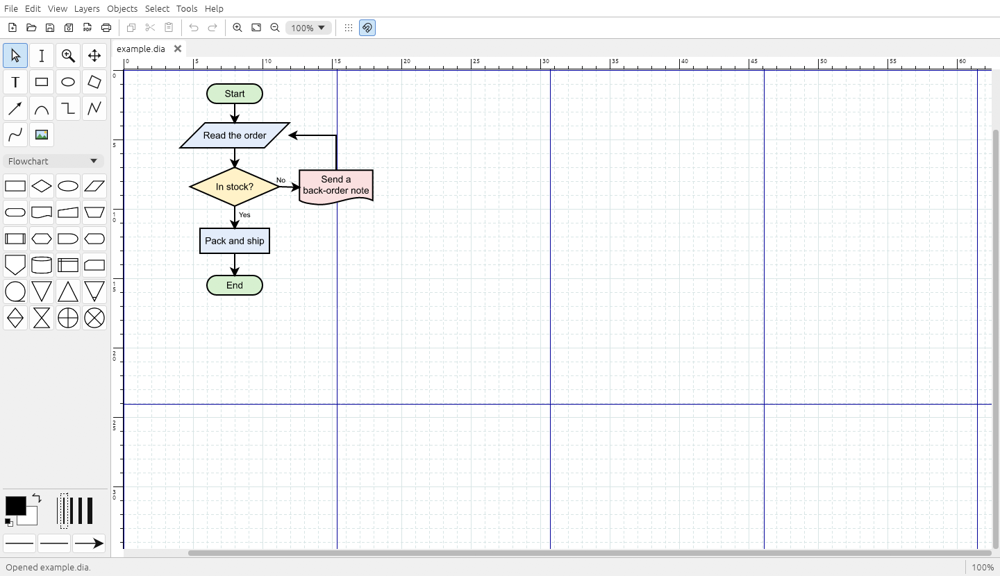

# ChartCraft

ChartCraft is a desktop app for drawing flowcharts, UML diagrams and database diagrams. It
opens and saves [Dia](http://dia-installer.de/) `.dia` files, exports to PDF, PNG and SVG, can
draw database tables straight from a MySQL server, and includes an MCP server so AI assistants
such as Claude Code can build diagrams for you.

It is written in Rust with [egui](https://github.com/emilk/egui) and builds to a single
`ChartCraft.exe` with nothing else to install.



## Features

- **Shape sheets** for Flowchart, UML, Database and Basic shapes, plus drawing tools for text,
  boxes, ellipses, polygons, straight lines, arcs, zigzag (right-angled) lines, polylines,
  Bézier curves and images.
- **Connected lines**: draw a line from one shape to another and its ends stay attached when
  you move the shapes.
- **UML classes and database tables** with attributes, operations and columns, edited in their
  own properties windows.
- **Dia file format**: reads and writes `.dia` files (plain or gzip-compressed XML), so diagrams
  can be shared with Dia.
- **Export** to PDF (at the diagram's size or fitted to a paper size), PNG or SVG, and print.
- **MySQL import**: pick tables from a database and add them as table shapes, or update tables
  already in the diagram.
- **Tabs** for several open diagrams, layers, grid and snapping, rulers, align and stacking
  order, and 200 steps of undo.
- **Light and dark themes** (View → Theme).
- **MCP server** for Claude Code and other AI tools (see [Using ChartCraft with Claude Code](#using-chartcraft-with-claude-code)).

## Using ChartCraft

### Drawing

- Pick a shape on the left, then click or drag on the diagram. Start typing to label it.
- Double-click a tool to keep using it; press **Esc** to go back to the arrow.
- Draw a line or zigzag from one shape to another: its ends stick to the shapes (shown with
  red handles) and follow them when they move.
- Double-click a shape to change its text, or a line to change its arrows and colour.
  **Alt+Enter** opens the full properties of the selection.
- Shift+click, or drag a box around objects, to select several. The arrow keys nudge them.
- **Ctrl + mouse wheel** zooms; the **middle mouse button** drags the view.
- The colour squares, line widths and arrow buttons at the bottom of the toolbox set the style
  of new objects, and of the selected objects too.

Help → Tips shows these hints inside the app, and Help → Open the example flowchart opens a
small example to play with.

### Keyboard shortcuts

| Action | Keys |
|---|---|
| New, open, save, save as | Ctrl+N, Ctrl+O, Ctrl+S, Ctrl+Shift+S |
| Close tab | Ctrl+W |
| Export to PDF, print | Ctrl+E, Ctrl+P |
| Undo, redo | Ctrl+Z, Ctrl+Y |
| Cut, copy, paste, duplicate, delete | Ctrl+X, Ctrl+C, Ctrl+V, Ctrl+D, Del |
| Select all, select none | Ctrl+A, Ctrl+Shift+A |
| Edit text, properties | F2, Alt+Enter |
| Bring to front, send to back | Ctrl+F, Ctrl+B |
| Zoom in, zoom out, 100%, best fit | Ctrl++, Ctrl+-, Ctrl+1, Ctrl+Shift+E |
| Tips | F1 |

### Importing tables from MySQL

File → Import tables from MySQL… connects to a MySQL server, lists the tables in a
database, and adds the ones you tick as table shapes with their columns and comments. Tables
that are already in the diagram can be updated in place, keeping their position and lines.

The connection list is filled in from connections already saved on the computer:

- HeidiSQL sessions (from the Windows registry),
- SQLyog connections (`%APPDATA%\SQLyog\sqlyog.ini`),
- a `connect.ini` file in the current folder or next to `ChartCraft.exe`.

You can also type the host, port, user and password yourself. The MySQL client is built into
the app; no MySQL software or extra DLLs are needed.

### Settings

ChartCraft keeps its recent-files list and theme choice in `%APPDATA%\ChartCraft\`
(`recent.txt` and `theme.txt`).

## Using ChartCraft with Claude Code

Run with `--mcp`, ChartCraft becomes an [MCP](https://modelcontextprotocol.io) server instead of
opening a window, so an AI assistant can create and edit `.dia` files. If the same file is open
in the app, it reloads automatically as the assistant changes it.

To add it to Claude Code (Help → Use with Claude Code (MCP)… in the app shows this command with
the right path filled in):

```
claude mcp add --scope user chartcraft -- "C:\path\to\ChartCraft.exe" --mcp
```

For other MCP clients, the JSON configuration is:

```json
{
  "mcpServers": {
    "chartcraft": {
      "command": "C:\\path\\to\\ChartCraft.exe",
      "args": ["--mcp"]
    }
  }
}
```

The server offers these tools: `new_diagram`, `list_shape_kinds`, `add_shape`, `add_text`,
`add_class`, `add_table`, `connect`, `update_object`, `delete_objects`, `list_objects`,
`layout`, `render_preview` and `export`. Coordinates are in centimetres.

## Building from source

### Requirements

- **Rust**, stable, installed with [rustup](https://rustup.rs).
- **On Windows**, the Microsoft C++ build tools, which Rust uses for linking. The rustup
  installer offers to install them; otherwise install "Desktop development with C++" from the
  [Visual Studio Build Tools](https://visualstudio.microsoft.com/visual-cpp-build-tools/).

### Build and run

```
git clone https://github.com/mikeprice99/ChartCraft.git
cd ChartCraft
cargo run --release
```

The finished program is `target/release/ChartCraft.exe`. It is self-contained: copy it anywhere
and run it. The first build downloads and compiles the dependencies, which takes a few minutes.

For a quicker build while working on the code, use `cargo build` (the result is
`target/debug/ChartCraft.exe`, which also opens a console window for messages).

### Tests

```
cargo test
```

### Other platforms

ChartCraft is developed and tested on Windows. The code is written to build on Linux and macOS
too, but those builds are untested. On Linux you will need the OpenSSL development package
(e.g. `libssl-dev`) and the usual system libraries for egui/eframe apps.

### Command-line options

| Option | What it does |
|---|---|
| `ChartCraft file.dia …` | Open one or more diagrams |
| `--mcp` | Run as an MCP server on stdin/stdout (no window) |
| `--theme light\|dark\|system` | Start with this theme without changing the saved choice |

These are mainly for checking the build:

| Option | What it does |
|---|---|
| `--screenshot out.png` | Open, save a screenshot of the window, and quit |
| `--sheet NAME` | Start with a shape sheet showing (e.g. `UML`) |
| `--props N` | Open the first object's properties on tab N |
| `--mysql` | Start with the MySQL import window open |
| `--help-mcp` | Start with the Claude Code help window open |

## Project layout

| Path | Contents |
|---|---|
| `src/main.rs` | Start-up and command-line options |
| `src/app*.rs` | The window: menus, toolbar, toolbox, drawing area, dialogs, MySQL import window |
| `src/editor.rs` | Editing: tools, selection, dragging, undo |
| `src/model.rs`, `src/record.rs` | The diagram model, UML classes and database tables |
| `src/shapes.rs` | Shape sheets and shape definitions |
| `src/dia.rs` | Reading and writing `.dia` files |
| `src/render.rs`, `src/skia.rs` | Drawing diagrams (on screen and to PNG) |
| `src/pdf.rs`, `src/svg.rs` | PDF and SVG export |
| `src/mysql_import.rs` | Saved connections and reading tables from MySQL |
| `src/mcp.rs`, `src/mcp_tools.rs` | The MCP server and its tools |
| `src/theme.rs`, `src/icons.rs` | Light/dark colours and toolbar icons |
| `assets/phosphor/` | The Phosphor icon font and its licence |

## Licence

ChartCraft is licensed under either of

- Apache License, Version 2.0 ([LICENSE-APACHE](LICENSE-APACHE)), or
- MIT licence ([LICENSE-MIT](LICENSE-MIT))

at your option.

The toolbar icons are from [Phosphor Icons](https://phosphoricons.com), MIT licence
([assets/phosphor/LICENSE](assets/phosphor/LICENSE)).
